<p align="center">
  
</p>

<p align="center">
  <a href="https://github.com/manishkumar632">
    
  </a>
</p>

<p align="center">
  <a href="https://www.linkedin.com/in/manishkumar632"></a>
  <a href="https://manishkumar632.github.io"></a>
  <a href="https://www.instagram.com/manishx404/"></a>
  
  
</p>

---

<a href="https://github.com/manishkumar632"></a>

### 🧑‍💻 About me

- 📱 **App developer**: I build cross-platform mobile apps with **Flutter & Dart**
- 🌐 **Full-stack developer**: React, Next.js, Node.js and Django on the web
- 🔨 Currently building a **desktop app** and my **portfolio site** in TypeScript
- 🤖 Exploring **AI/ML open-source projects** that drive real-world impact
- 🌱 From mobile apps to data science, I love turning ideas into shipped products
- 💬 Ask me about **Flutter, React, Node.js, Python or TensorFlow**
- ⚡ Fun fact: one codebase, every screen. That's why I love Flutter

<br clear="right" />

### 🎯 Me, in Dart

```dart
class Manish extends Developer {
  final String name = "Manish Kumar";
  final List<String> roles = ["Full-Stack Developer", "App Developer 📱"];

  final Map<String, List<String>> stack = {
    "mobile":  ["Flutter", "Dart"],
    "web":     ["React", "Next.js", "Node.js", "Express", "Django"],
    "ai_ml":   ["Python", "TensorFlow", "Pandas"],
    "also":    ["Java", "C++", "TypeScript", "MongoDB"],
  };

  final List<String> currentlyBuilding = ["Desktop app", "Portfolio site"];

  String sayHi() => "Thanks for dropping by! Let's build something 🚀";
}
```

### 🛠️ Tech stack

| | |
|:--|:--|
| 📱 **Mobile** |  |
| 🌐 **Web** |  |
| 🤖 **AI / ML** |  |
| 💻 **Languages** |  |
| 🗄️ **Data & tools** |  |

### 🌟 Featured projects

| Project | What it is | Built with |
|:--|:--|:--|
| 🌾 **[Farm-D-Care](https://github.com/manishkumar632/Farm-D-Care)** | Mobile app for farmers | Flutter · Dart |
| ✅ **[Team-Task-Manager](https://github.com/manishkumar632/Team-Task-Manager)** | Team task management app | Full-stack |
| 🌐 **[Portfolio](https://manishkumar632.github.io)** | My personal portfolio site | TypeScript |
| ⚡ **Smart Charging Control System** | Smart charging controller | |
| 🏠 **House Price Prediction** | ML model for price estimation | Python · ML |

### 📊 GitHub stats

<p align="center">
  
  
</p>

<p align="center">
  
</p>

### 🏆 Trophies

<p align="center">
  
</p>

### 📈 Contribution activity

<p align="center">
  <picture>
    <source media="(prefers-color-scheme: dark)" srcset="https://raw.githubusercontent.com/manishkumar632/manishkumar632/output/github-snake-dark.svg" />
    <source media="(prefers-color-scheme: light)" srcset="https://raw.githubusercontent.com/manishkumar632/manishkumar632/output/github-snake.svg" />
    
  </picture>
</p>

### 💡 Dev quote of the moment

<p align="center">
  
</p>

<p align="center"><i>"Code. Learn. Ship. Repeat."</i> ⭐</p>

<p align="center">
  
</p>
